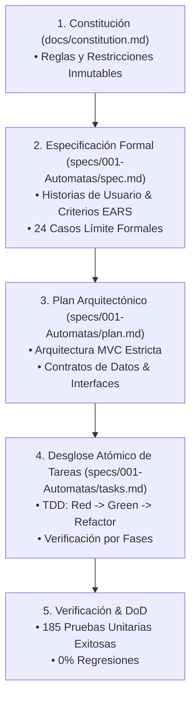

# Autómatas (AFD / AFN) — Entorno de Diseño Visual, Simulación y Conversión

[](https://openjdk.org/)
[](https://openjfx.io/)
[](https://maven.apache.org/)
[](https://junit.org/)
[](docs/manual_de_usuario.md)
[-8B5CF6)](specs/001-Automatas/)

Aplicación de escritorio moderna construida en **Java 17** y **JavaFX** para el diseño interactivo mediante *Drag and Drop*, simulación con trazabilidad paso a paso y conversión formal de **Autómatas Finitos Deterministas (AFD)** y **No Deterministas (AFN)** sin transiciones vacías ($\varepsilon$).

---

## 📖 Documentación Principal

- 📘 **[Manual de Usuario Completo](docs/manual_de_usuario.md)**: Guía paso a paso ilustrada para el diseño, simulación, trazabilidad de cadenas y conversión a AFD.
- 📜 **[Constitución del Proyecto](docs/constitution.md)**: Principios de gobernanza técnica, desacoplamiento MVC y restricciones cromáticas.
- 📐 **[Especificación Funcional (SDD)](specs/001-Automatas/spec.md)**: Requisitos formales EARS y catálogo de 24 casos límite.

---

## 1. Metodología de Desarrollo: SDD (Specification-Driven Development)

El proyecto fue concebido, diseñado y construido siguiendo rigurosamente la metodología **SDD (Desarrollo Guiado por Especificaciones)**. A diferencia de los enfoques ad-hoc, SDD establece una cadena formal e inmutable donde **el código nunca se escribe sin una especificación contractual previa aprobada**.



---

## 2. Características del Sistema

- **Definición Estricta del Alfabeto ($\Sigma$):** Admite exclusivamente letras individuales (`a-z`, `A-Z`) separadas por comas con bloqueo preventivo ante transiciones activas.
- **Lienzo Visual Interactivo (Drag & Drop):** Creación dinámica de nodos con numeración correlativa automática ($q_0, q_1, q_2, \dots$), renombrado interactivo y eliminación en cascada.
- **Transiciones y Autolazos Inteligentes:** Diálogo asistido para selección de símbolos, unificación de flechas en el mismo sentido, arcos curvados anticolisión en transiciones bidireccionales y lazos reflexivos superiores.
- **Clasificación Reactiva en Tiempo Real:** Detección matemática continua del estado formal del autómata (`«Sin estados»`, `«AFD»` o `«AFN»`).
- **Simulación y Trazabilidad Paso a Paso:** Evaluación binaria inmediata (`«Aceptada»` / `«Rechazada»`) con desglose gráfico del recorrido de estados y prioridad visual para los caminos aceptados.
- **Conversión AFN a AFD (Construcción de Subconjuntos):** Generación automática de una nueva pestaña protegida con disposición circular equidistante y tabla viva de subconjuntos.
- **Gestión Multi-Pestaña Segura:** Confirmación preventiva ante cierre involuntario y regeneración automática si se cierran todas las pestañas.
- **Personalización Temática (Modo América):** Botón de alternancia a paleta escarlata y blanca con marca de agua oficial en el fondo del tablero.

---

## 3. Instrucciones de Ejecución

### Ejecución Directa (Desarrollo)
```bash
mvn javafx:run
```

### Ejecutar Pruebas Automatizadas
```bash
mvn test
```

### Empaquetar para Producción
```bash
mvn clean package
```
El archivo JAR ejecutable se generará en `target/automatas-1.0.0-SNAPSHOT.jar`.
